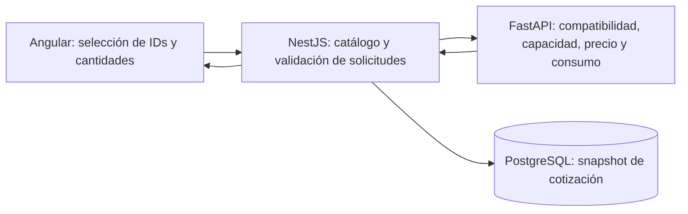

# Cotizador EP2: flujo y estado de implementación

## Flujo implementado

Ampliación 18/10: [22 opciones adicionales, fuentes y alcance real del selector de uso](catalogo-ampliado.md). Los precios nuevos son estimaciones explícitas, no ofertas importadas.

Actualización posterior: [importación al armador desde SoloTodo](catalogo-solotodo.md) con fotos, ofertas, límites por categoría y datos por confirmar. No modifica el comportamiento del selector de uso ni snapshots anteriores.

1. Tres presets visuales centrados (día a día, gaming, creador) y una franja destacada «Personalizado / Crear mi PC» debajo para empezar desde cero. Foto de referencia, título y precio estimado a primera vista; especificaciones de los presets al pasar el cursor, enfocar con teclado o tocar el ojo. Un preset abre directamente el resumen y permite editar cualquier categoría. La información extensa de procedencia se conserva en la documentación, no en un desplegable de la pantalla.
2. Procesador: primero AMD/Intel, luego modelos; opción Ver todos.
3. Gráfica: primero NVIDIA/AMD, integrada o Ver todas.
4. Placa madre: modelos MSI AM4/AM5/LGA1700 con foto, ranuras RAM, capacidad máxima, M.2/SATA, formato y conectividad. Los perfiles genéricos anteriores siguen resolviéndose, pero solo aparecen si ya estaban seleccionados.
5. RAM: solo módulos individuales entre las opciones nuevas: 8/16/32 GB DDR4 y 8/16/32/64 GB DDR5. Cantidad elegible por tarjeta; 2 × 16 GB son 32 GB y dos ranuras. Prioriza ofertas de módulos individuales importados; completa capacidades faltantes con perfiles estimados, fotos de familia y datos explícitos, sin dividir kits. Los kits anteriores conservan sus IDs/precios para armados existentes.
6. Almacenamiento: HDD, SSD SATA y SSD NVMe; varias unidades y cantidades.
7. Refrigeración por aire y líquida AIO en grupos separados, con filtros visibles; ventilador y soporte opcionales debajo, sin añadir otro paso. Los modelos DeepCool tienen fotos y datos de montaje. El cooler incluido no usa una foto ajena: depende de la presentación del procesador.
8. Gabinetes Fractal/Corsair con foto y ficha de formatos, GPU/cooler, radiadores, bahías y ventiladores. Las notas explican restricciones y distribuciones; la revisión sigue siendo preliminar.
9. Fuente: 57 perfiles estimados, potencias 450/550/650/750/850/1000/1200 W, formatos ATX/SFX/SFX-L y cableado no modular/semimodular/modular. Fotos oficiales referenciales, no modelos ofertados. Abre con todas las potencias, sin fijar automáticamente la mínima recomendada; muestra incompatibles identificados, sin permitir un montaje inseguro.
10. Resumen compacto con edición por categoría. Pantalla separada para nombrar y guardar; consulta opcional, desactivada por defecto. El nombre se conserva en historial de cliente y administrador.

El detalle de componentes también se muestra en las cotizaciones del cliente y del administrador.

## Responsabilidades

- `GET /api/catalog`: catálogo público, versión y aviso de procedencia.
- `POST /api/builds/preview`: revisión pública de un borrador parcial, sin persistencia.
- `POST /api/builds`: revisión y guardado; requiere JWT. No guarda armados incompletos o bloqueados.
- `POST /builds/preview` en FastAPI: procesamiento interno de las fichas resueltas por NestJS.
- Se mantienen los endpoints EP1 para no romper la compatibilidad con clientes anteriores.

El navegador envía IDs de catálogo y cantidades, no precios ni capacidades de confianza. NestJS obtiene las fichas del catálogo del servidor. Python calcula los totales y las reglas. El frontend realiza filtros orientativos de presentación; la decisión al guardar vuelve a pasar por el backend.

## Reglas y límites

- Capacidad y precio de almacenamiento sumados por cada unidad y su cantidad.
- Límites de puertos SATA, ranuras M.2, módulos RAM y capacidad máxima de placa.
- Validación de socket, tipo DDR y disponibilidad de gráficos/cooler incluidos.
- Revisión de espacio de gráfica, altura de cooler, radiador y bahías de gabinete.
- Los ventiladores incluidos con el gabinete tienen consumo pero no se cobran de nuevo.
- Los ventiladores y la bomba del AIO están incluidos en su perfil de precio y consumo.
- Política de fuente centralizada en Python: máximo entre `ceil(consumo × 1.35 / 50) × 50` y el mínimo de PSU declarado por el fabricante de la GPU.
- La potencia eléctrica es una estimación, no una medición. Se revisan formato físico y conectores declarados.
- Un cambio de piezas conserva las selecciones anteriores y vuelve a comprobar incompatibilidades.
- El borrador se conserva en `sessionStorage` con versión de catálogo, para recargar o iniciar sesión en la misma pestaña.
- Si cambian piezas después de guardar, se invalida la asociación al ID de la cotización anterior.
- Las migraciones agregan columnas opcionales `configuration`, `recommended_psu_watts` y `name`; conservan cotizaciones EP1.
- El contrato nuevo acepta `memory: [{id, quantity}]`. El campo anterior `ram` sigue siendo válido para clientes EP1, pero no puede combinarse con `memory` no vacío. Se rechazan IDs repetidos: se debe usar cantidad.
- Se eliminó la opción separada «Ajústate a tu presupuesto» para evitar entradas redundantes. El presupuesto y uso se definen dentro de Personalizado y siguen comparándose con el total durante el armado. Los borradores antiguos del modo presupuesto se recuperan como personalizados sin perder sus piezas.

## Procedencia: estado real

El catálogo actual es **manual y de referencia**, no una recuperación automatizada desde la Web.

CPU, RAM y discos incluyen modelos/familias identificados. Las cuatro GPU dedicadas se identifican como MSI Ventus o Sapphire PULSE con dimensiones, consumo y mínimo de fuente contrastados con sus fichas. Se añadieron seis placas MSI, cuatro coolers DeepCool, tres gabinetes Fractal/Corsair y dos accesorios DeepCool con fuentes oficiales en `backend/src/catalog/catalog.hardware.ts`. Las fuentes de poder siguen siendo perfiles genéricos. Los IDs antiguos se conservan para recuperar borradores y cotizaciones; no se les asignan fotos de modelos diferentes.

El catálogo es `ep2-reference-3`; se recuperan borradores de las versiones 1 y 2 conservando IDs y cantidades válidas. Los presets nuevos usan placas/gabinetes concretos. Meshify 2 usa un límite GPU conservador de 315 mm en distribución de almacenamiento; no se debe confundir con el máximo del modo abierto. Los montajes simultáneos de radiador/ventiladores/bahías, el ancho E-ATX, la altura de RAM y la longitud de PSU requieren confirmar ficha/manual. La estimación no certifica esas combinaciones.

Personalizado tiene un barrido de luz y movimiento leve del icono, desactivados con `prefers-reduced-motion: reduce`. La ficha integrada ya no usa el dibujo de una tarjeta dedicada.

Pulsar la imagen, el texto o el fondo de una tarjeta alterna agregar/quitar el componente. En piezas con cantidad, quitar retira todas sus unidades; los botones +/− ajustan unidades sin alternar la tarjeta. Los botones secundarios de montaje y foto son independientes. «Foto» abre un diálogo ampliado sin navegar ni modificar la selección, cerrable con su botón, Escape o el fondo exterior. Las tarjetas se pueden accionar con Tab y Enter/Espacio. Una pieza incompatible no se puede agregar, pero sí quitar si estaba seleccionada.

Los precios son ilustrativos en CLP, no ofertas vigentes ni garantía de stock. CPU, GPU, RAM y discos enlazan fotografías reales con crédito y origen visibles; algunas variantes comparten una foto de familia. Los perfiles sin modelo definitivo mantienen SVG, sin asignarles una foto de un producto diferente. Ante un fallo de imagen se muestra una ilustración de respaldo. Ver [fuentes y derechos de fotos](imagenes-cotizador.md).

Esta fase permite probar el flujo, las cantidades, las reglas y la persistencia. **No satisface todavía los criterios de EP2 de extracción web real, trazabilidad de recuperación y evaluación de calidad de esos datos.**

No se garantiza compatibilidad completa de BIOS, generaciones PCIe, ancho de banda, puertos compartidos, espacio de RAM bajo torres, montaje mixto de ventiladores o pérdida de espacio de GPU al instalar radiador frontal. Estas comprobaciones requieren fichas reales por modelo y, cuando corresponda, revisión manual.

## Verificación

### Edición rápida de cotizaciones guardadas

La tarjeta personal muestra nombre, fecha, estado, RAM, almacenamiento, evaluación y total; no muestra bloques de presupuesto, disponible o excedente. Evaluación es un desplegable compacto. **Componentes del equipo** abre directamente el editor modal, sin pasar por una lista estática. El borrado permanece arriba a la derecha y el total abajo a la derecha. Las métricas financieras y el desglose de piezas de la vista admin, y las reglas del cotizador, se conservan.

**Nueva cotización** en el historial y **Cotizar otro PC** en la pantalla de guardado vuelven al inicio con los presets, sin tocar cotizaciones persistidas. Se limpian piezas, filtros, nombre y datos de coordinación del borrador local. Si aún no se guardó y contiene piezas, el botón del cotizador pide confirmación. Mientras guarda o envía una consulta no permite reiniciar. Las respuestas de evaluación anteriores se cancelan inmediatamente al cambiar o reiniciar el borrador.

En **Mis cotizaciones → Componentes del equipo** hay una ventana compacta de selectores por categoría, con fotos pequeñas, cantidades y subtotales. RAM, discos, ventiladores y soportes admiten filas adicionales sin repetir modelos; se ajusta la cantidad en la misma fila. Los perfiles antiguos solo aparecen si estaban seleccionados.

El editor recupera los IDs y cantidades del snapshot, consulta los precios actuales del catálogo manual y vuelve a evaluar el armado con FastAPI. Cambiar una pieza no borra automáticamente las demás: las incompatibilidades se muestran y bloquean el guardado. Cancelar no modifica la cotización.

- Una cotización propia en estado `DRAFT`, sin consulta retirada, se actualiza con `PATCH /api/builds/:id`. Requiere sesión, propiedad y `expectedUpdatedAt` para evitar sobrescribir otra sesión; se valida otra vez en el servidor y no se aceptan precios enviados por el cliente.
- Si hay consulta, coordinación o historial cerrado/retirado, **Guardar copia** crea otra cotización (`POST /api/builds`) y conserva el original y su coordinación. No se modifica el armado acordado con el taller.
- Una cotización antigua sin snapshot no permite esta edición porque no es posible reconstruir sus piezas con certeza.

### Pruebas

- Angular: pruebas de unidades mixtas, recuperación del borrador, cantidades y descarte de evaluación anterior.
- NestJS: resolución de catálogo, categorías inválidas, duplicados, guardado de snapshot y caídas de Python.
- Python: presupuesto, potencia, unidades mixtas, límites de montaje y contrato del endpoint.
- Integración HTTP real NestJS–FastAPI–PostgreSQL: `node --test tests/integration/builds.test.mjs` con servicios iniciados.
- El job Docker de CI construye Compose, ejecuta estas pruebas y detiene su ambiente temporal.
- `builds.test.mjs` solo consulta y valida; no crea usuarios ni cotizaciones.
- `edit-builds.test.mjs` se ejecuta dentro del backend local mediante el comando indicado en su cabecera. Comprueba edición autenticada, cantidades persistidas, propiedad, versiones concurrentes, incompatibilidades y copia de una cotización con consulta. Crea dos cuentas QA y sus cotizaciones temporales, y elimina exclusivamente esos registros al finalizar; no modifica cotizaciones reales.

## Continuidad de EP2 — estado actual

El piloto ahora usa SoloTodo para CPU, con recuperación bajo demanda, preparación Python, persistencia de referencias/corridas y consulta privada en Angular. Es un flujo separado: **no reemplaza el catálogo manual en memoria** ni incorpora automáticamente precios, fotos o recomendaciones externas. Ver [evidencia y límites](entrega-2.md).

Controles de [seguridad](seguridad-ep2.md) y [observabilidad](observabilidad-ep2.md) implementados localmente; falta validación remota final y staging automatizado. El [diseño adaptativo](diseno-adaptativo-ep2.md) ya está especificado, no implementado como motor.

Se aplicó una [evaluación acotada de cinco CPU reales](fuente-web-evaluacion.md) y se actualizó el [tablero local](tablero-ep2.md). Pendientes: derechos de reutilización, cobertura/mapeo revisado, validación remota, alojamiento/despliegue y cierre de evidencia/tag. Ver [cierre EP2](cierre-ep2.md). Mercado Libre sigue como alternativa histórica, no integración en curso.

## Dependencias

La corrección inicial de `proxy-addr` y los parches posteriores están registrados en [seguridad EP2](seguridad-ep2.md). Persisten hallazgos de herramientas de desarrollo e imágenes que requieren revisión; no se declara ausencia de vulnerabilidades. Se conservan las versiones mayores de Angular, NestJS y Prisma.
