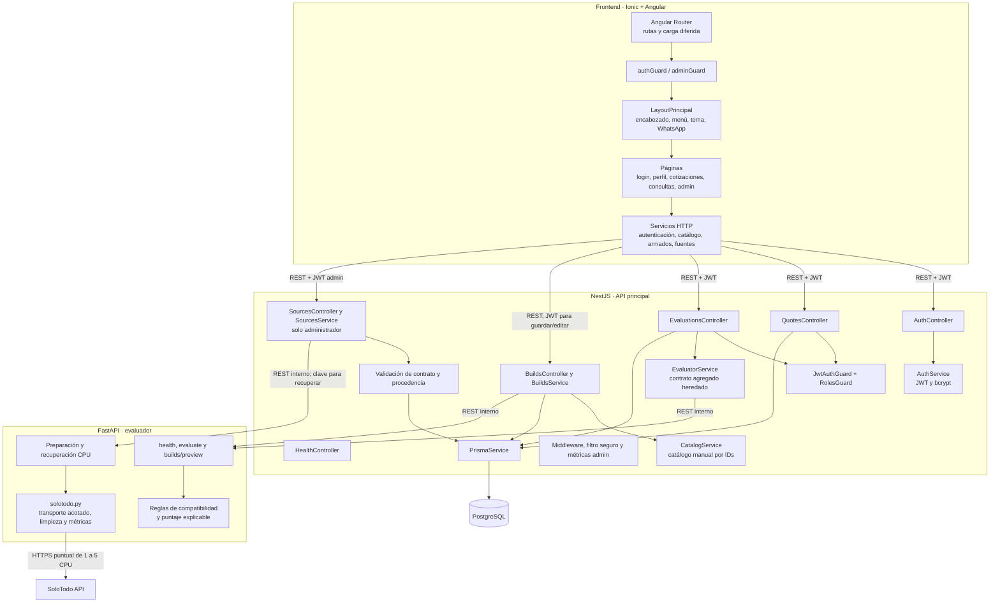

# Diagrama de componentes — EP2

Estado implementado al 2026-10-17. El recomendador contextual futuro no forma parte del diagrama. El contrato agregado de evaluación EP1 sigue disponible, pero el cotizador nuevo usa el flujo por componentes descrito abajo.

## Componentes del frontend

| Grupo | Componentes reales | Función |
| --- | --- | --- |
| Navegación | `app.routes.ts`, `autenticacion.guard.ts` | Protege perfil, cotizaciones, consultas y la vista administrativa. |
| Diseño compartido | `LayoutPrincipalComponent`, `EncabezadoComponent`, `MenuLateralComponent`, `BotonTemaComponent`, `BotonWhatsappComponent`, `FondoCircuitosComponent` | Mantiene la interfaz consistente en las rutas internas. |
| Páginas | Cotizador, historial/editor, consultas, clientes y `FuentesComponent` | Implementan los recorridos; fuentes solo para administrador desde el menú de cuenta. |
| Comunicación | Servicios de autenticación, cotizaciones, catálogo/armados y `FuentesService` | Encapsulan llamadas a NestJS; interceptor JWT centralizado. |

## Componentes del backend

| Componente | Función |
| --- | --- |
| `AuthController` y `AuthService` | Registro, login, perfil y actualización de datos con contraseña actual. |
| `JwtAuthGuard` y `RolesGuard` | Autentican tokens y restringen acciones administrativas. |
| `EvaluationsController` y `EvaluatorService` | Validan una solicitud, consultan FastAPI y guardan su resultado. |
| `QuotesController` | Entrega historial privado y permite solicitar/administrar la coordinación. |
| `PrismaService` | Único acceso a PostgreSQL desde NestJS. |
| `BuildsController` y `BuildsService` | Preview público y guardado/edición propios autenticados; resuelven catálogo, snapshot y concurrencia. |
| `CatalogController` y `CatalogService` | IDs y cantidades; precios/especificaciones enviados por Angular no son autoridad. |
| `SourcesController` y `SourcesService` | Inician auditoría, controlan espera/concurrencia, coordinan Python y persisten en transacción. |
| `source.contract.ts` | Valida identidad, hash, métricas y procedencia antes de persistir. |
| Observabilidad | Correlación HTTP/dependencia, duración, errores seguros y métricas privadas por proceso. |
| `HealthController` | Verifica NestJS y PostgreSQL; no garantiza disponibilidad de SoloTodo. |

## Flujo principal de una cotización

1. Angular consulta `GET /api/catalog` y construye un borrador de IDs/cantidades.
2. `POST /api/builds/preview` no persiste. NestJS resuelve el catálogo y llama a `/builds/preview` Python.
3. Python devuelve análisis, piezas faltantes, bloqueos/advertencias y totales estimados.
4. `POST /api/builds`, autenticado, reevalúa y guarda un snapshot propio.
5. `PATCH /api/builds/:id` valida propiedad, estado y `expectedUpdatedAt`. Si hay coordinación, se conserva el flujo de guardar copia en lugar de alterar lo acordado.
6. Las rutas de cotizaciones gestionan consulta, coordinación y borrado lógico, separados de recuperación externa.

## Flujo de referencia externa

1. Administrador confirma recuperación de 1–5 CPU en el panel.
2. NestJS registra `SourceRun`, controla límites y llama a Python con clave interna.
3. Python recupera y prepara; NestJS valida y confirma fichas/corrida en transacción.
4. La UI consulta referencias e historial. Un fallo conserva la última ficha válida y produce error seguro.
5. Recuperar no crea un producto interno ni modifica una cotización. JSON declarado sigue identificado como tal.

`builds.py` evalúa un armado, no ordena productos. `solotodo.py` no recupera precios ni imágenes. Los middleware de observabilidad no registran cuerpos/credenciales; `requestId` HTTP y `runId` de adquisición son identidades distintas.

Contratos y evidencia: [plan EP2](entrega-2.md). Evolución propuesta: [diseño adaptativo](diseno-adaptativo-ep2.md).
