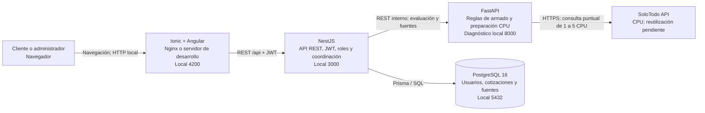

# Diagrama de contenedores — EP2

Este diagrama explica los bloques ejecutables de JembaTech y cómo se comunican. El navegador nunca accede directamente a PostgreSQL ni a FastAPI.

El esquema conserva puertos/versión PostgreSQL del entorno local. Para Railway
staging (PostgreSQL 18), HTTPS, red privada y CD comprobados, ver el
[despliegue vigente](railway-staging.md). No representa una segunda exposición
pública de Python o la base.

## Responsabilidad por contenedor

| Contenedor | Tecnología | Responsabilidad | Exposición |
| --- | --- | --- | --- |
| Frontend | Ionic + Angular | Interfaz, navegación, formularios y presentación de evaluaciones/cotizaciones. | Pública, `localhost:4200` en desarrollo. |
| API principal | NestJS | DTO, JWT/roles, catálogo manual, cotizaciones, auditoría de fuentes y observabilidad privada. | `/api`; `localhost:3000/api` para desarrollo. |
| Evaluador/preparador | FastAPI | Analiza armados y recupera/normaliza CPU; no persiste ni emite JWT. | Interna; `127.0.0.1:8000` solo para diagnóstico local. |
| Base de datos | PostgreSQL 16 | Usuarios, hashes de contraseña, snapshots, referencias y corridas. | Interna; `5432` solo para desarrollo local. |

## Decisiones relevantes

- NestJS es la única puerta de entrada pública de datos: concentra seguridad, validación y errores.
- FastAPI no guarda datos ni entrega JWT. La recuperación exige una clave interna distinta al JWT; nunca recibe el token del usuario.
- SoloTodo se consulta por acción administrativa, una página fija y sin datos personales. Abrir el panel lee PostgreSQL, no consulta al proveedor.
- Las referencias permanecen fuera del catálogo. Condiciones de reutilización/republicación y muestra representativa pendientes.
- Nginx, NestJS y FastAPI producen eventos de observabilidad; NestJS coordina `X-Request-Id` con Python. No hay colector central; staging público y salud están comprobados según el enlace vigente.
- Railway usa HTTPS y mantiene Python/PostgreSQL en red privada; HTTP y puertos locales del esquema no son una configuración cloud.
