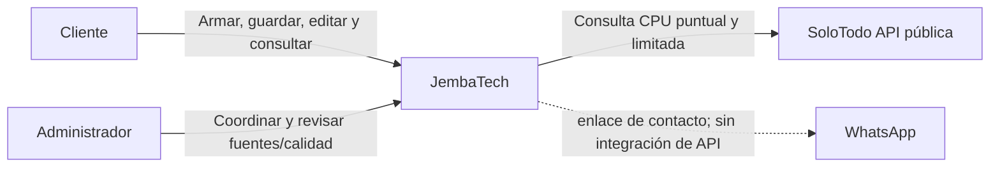

# Diagrama de contexto — EP2

SoloTodo aporta referencias técnicas al piloto privado, no un catálogo comercial sincronizado. Acceso técnico no equivale a derechos de reutilización. El cliente no recibe esas referencias como recomendaciones automáticas.

WhatsApp continúa el contacto manual; no se envían automáticamente todas las cotizaciones. La descomposición técnica y los límites de acceso están en [contenedores](diagrama-contenedores.md).
