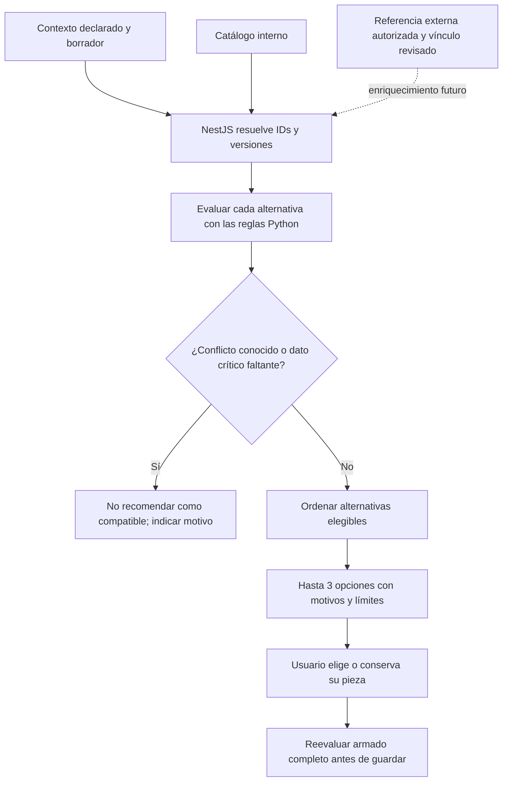

# Diseño adaptativo preliminar — EP2

Fecha: 2026-10-17. Estado: **especificación, no motor de recomendaciones implementado**. Esta es una decisión de diseño de JembaTech para cubrir el diseño preliminar de la entrega; no implica que la pauta exija IA generativa, entrenamiento o un proveedor concreto.

## Objetivo y usuario

Ayudar a una persona que está armando o modificando un PC a encontrar alternativas compatibles y entender por qué se sugieren. El usuario objetivo conoce su uso principal, pero no necesariamente sockets, tipos de RAM, conectores o límites de montaje.

La parte que se adaptará es el **orden y la explicación de las alternativas de componentes** según el armado actual y las preferencias declaradas. No se personalizarán precios ni se inferirán ingresos, comportamiento o identidad. El administrador revisará las referencias externas antes de incorporarlas a ese proceso.

Primer alcance propuesto: alternativas de CPU del catálogo interno. La fuente externa del piloto solo recupera fichas CPU; no sustenta todavía recomendaciones de todas las categorías. Las reglas actuales del armado completo seguirán validando las consecuencias de un cambio.

## Qué existe y qué se propone

| Capacidad | Estado real |
| --- | --- |
| Catálogo manual, presets, filtros y elección por categoría | Implementados. Los precios son referencias, no ofertas vigentes. |
| Evaluación de la configuración y alertas técnicas | Implementada en `python-service/builds.py`; el servidor resuelve IDs, precios y fichas. |
| Puntaje actual | `max(0, 100 − 25 × bloqueos − 10 × advertencias)`. No mide FPS, calidad de una CPU ni probabilidad de satisfacción. La configuración incompleta se informa por separado. |
| Recuperación, limpieza, métricas y consulta privada de CPU externas | Piloto implementado; evaluación acotada de cinco CPU reales, antiguas y no representativas. No actualiza el catálogo ni el cotizador. |
| Correspondencia revisada entre ficha externa y producto interno | Pendiente. `internalCatalogId` es opcional; tener ese campo no significa que exista un flujo de aprobación. |
| Ranking contextual, explicaciones por alternativa y política versionada | Propuestos en este documento. No existe un endpoint de recomendaciones. |
| Aprendizaje, perfiles históricos y A/B | Fuera de esta implementación EP2. La evaluación de utilidad posterior se propone abajo, no se presenta como realizada. |

El puntaje actual tampoco sustituye la condición `can_save`: para guardar se requieren todas las categorías obligatorias y ningún bloqueo técnico.

## Entradas, autoridad y datos faltantes

| Entrada | Origen | Uso propuesto / tratamiento |
| --- | --- | --- |
| IDs de piezas y cantidades | Borrador o snapshot propio | NestJS resuelve el catálogo; nunca aceptar especificaciones o precios como autoridad desde Angular. |
| Uso: oficina, estudio, gaming, programación o edición | Declaración explícita del usuario | Seleccionar objetivos orientativos de capacidad, no prometer rendimiento medido. |
| Preferencia AMD/Intel u otra preferencia disponible | Elección explícita en el flujo | Filtro reversible. Nunca superar una incompatibilidad para cumplir una marca. |
| Presupuesto | El contrato actual lo requiere | No reintroducir los bloques de presupuesto/excedente retirados de las tarjetas. El ranking futuro solo lo usará si la persona elige aplicarlo; no asumir que un valor recuperado es un límite consentido. |
| Precio y disponibilidad | Catálogo manual; sin stock verificado | Comparar únicamente estimaciones identificadas como tales. No interpretar precio externo nulo como cero. |
| Socket, marca, Part Number, núcleos/hilos y TDP | Referencia CPU externa normalizada | Solo enriquecer después de autorizar uso y revisar correspondencia. Núcleos/hilos no bastan para ordenar rendimiento entre generaciones. TDP no reemplaza `power` ni el consumo máximo. |
| URL, hash, modo y fechas de la referencia | Recuperación/auditoría | Explicar procedencia, distinguir JSON declarado de API y detectar cambios o falta de vigencia. |

No enviar cuentas, correos, teléfonos, direcciones, presupuesto ni el armado del cliente a SoloTodo. La recuperación actual tiene URL fija y no depende de esos datos.

### Puerta de entrada para datos externos — pendiente

Antes de afectar recomendaciones se necesitarán **todas** estas condiciones:

1. Condiciones de uso, atribución y exposición resueltas. `reuse-not-confirmed` impide incorporar la referencia al recomendador público.
2. Identidad revisada por administrador mediante SKU/Part Number y especificaciones; no vincular solo por nombre. Si no hay evidencia suficiente, queda sin mapear.
3. Registro de quién revisó, cuándo, con qué hash y qué campos aprobó. El campo actual `internalCatalogId` por sí solo no ofrece esa auditoría; habrá que diseñar e implementar su persistencia.
4. Los conflictos con el catálogo manual deben quedar para revisión; no sobrescribir socket, precio o potencia automáticamente. Un cambio de hash invalida la aprobación de los campos afectados hasta nueva revisión.
5. Procedencia y fechas visibles donde se use la información. Una consulta reciente no convierte en actual una ficha antigua.

Propuesta inicial para discutir: solicitar revisión si han pasado más de 30 días desde la comprobación de un vínculo. **No es una política activa ni una frecuencia de extracción**, y debe ajustarse a condiciones del proveedor y resultados del piloto. Una fecha antigua o desconocida exige cautela; no demuestra por sí sola que el producto sea incompatible.

Hasta cumplir esas condiciones, el recomendador futuro podría funcionar solo con datos manuales identificados como tales. No se afirmará entonces que recomienda a partir de datos externos. El piloto web EP2 se demuestra separadamente en el panel administrativo.

## Decisión propuesta: reglas y orden explicable

Elegimos reglas deterministas y orden lexicográfico para una primera versión. Permiten revisar cada decisión sin entrenamiento ni atribuir precisión general a una muestra real pequeña/no representativa. No se propone un modelo generativo que invente piezas, especificaciones o precios.

### 1. Seguridad técnica antes de preferencia

Sustituir temporalmente una pieza del borrador y volver a evaluar el conjunto. Comprobar socket/DDR, gráfica integrada, módulos y capacidad RAM, puertos de discos, espacio/montaje y potencia/conectores según corresponda. No modificar silenciosamente otras piezas para que la alternativa funcione.

- Un conflicto técnico conocido excluye la alternativa del grupo recomendado. Si el armado ya tiene otros bloqueos, se muestran aparte; no se presenta como compatible hasta resolverlos.
- Un dato técnico crítico desconocido se marca **por verificar**, no se completa con cero ni se toma como compatible. Este manejo explícito de desconocidos es una ampliación futura, no una garantía de las reglas actuales.
- Un borrador incompleto permite sugerir un punto de partida, pero debe indicar qué comprobaciones faltan. No llamarlo “PC compatible” todavía.
- BIOS, QVL, puertos compartidos y montaje real requieren revisión. Las reglas actuales trabajan con perfiles de referencia y no certifican el producto final.

La política de fuente actual conserva `max(redondeo_50W(consumo_estimado × 1,35), mínimo_GPU)`, además de formato y conectores. Modularidad no significa mayor potencia ni mejor calidad. La futura recomendación no la reemplazará usando solo TDP de CPU.

### 2. Orden entre opciones elegibles

Orden propuesto, de mayor a menor prioridad:

1. Cumplir filtros expresamente solicitados. Si no hay opciones, informar el vacío y permitir quitar el filtro; no hacerlo automáticamente.
2. Cumplir objetivos técnicos del uso que sí puedan justificarse con los datos disponibles. En CPU no se afirmará mayor rendimiento por contar más núcleos. Mientras falten benchmarks comparables, ese criterio no distingue CPUs.
3. Si el usuario activó límite económico: priorizar configuraciones completas cuyo total estimado no lo exceda. Con armado incompleto solo se conoce un subtotal; no prometer ajuste al presupuesto final.
4. Menor cantidad de advertencias no bloqueantes conocidas, con explicación. Lo desconocido no se premia como ausencia de advertencias.
5. Menor total estimado manual entre opciones equivalentes; desempate estable por ID interno.

Se muestra un máximo propuesto de tres alternativas y nunca se selecciona una automáticamente. No se calcula un “porcentaje de confianza” sin calibración. Si no existe ninguna alternativa verificable, la salida válida es “No tenemos una alternativa verificable con estos filtros”.

## Salida e interacción propuestas

En la categoría correspondiente, un control opcional **Ver alternativas** abriría una vista compacta coherente con el editor actual. Esta UI todavía no se agrega.

Cada opción indicaría modelo, imagen disponible, precio estimado, diferencia con la pieza actual, dos motivos breves y las verificaciones pendientes. Detalles de procedencia/fechas quedarían desplegables, sin saturar las tarjetas. Se conservarán los temas verde y cian.

Ejemplo conceptual, **no resultado de una recomendación ejecutada**:

> Misma plataforma que tu placa. Menor total estimado con los precios manuales actuales. Confirma BIOS del modelo final; no disponemos de una comparación de FPS.

La persona podrá elegir, ignorar y volver a su selección previa. Aplicar una alternativa solo cambia el borrador; guardar exige nueva evaluación servidor. Una cotización con coordinación conserva el flujo existente de guardar copia, no se altera el acuerdo del taller.

## Contrato y trazabilidad futuros

No se añaden rutas, migraciones o tablas en este corte. Se propone una futura operación en NestJS que reciba el borrador actual más categoría, filtros y preferencia económica explícita. NestJS resolverá los IDs y enviará a Python solo datos técnicos necesarios.

La respuesta deberá incluir versión de política y catálogo, alternativas con IDs internos, motivos estructurados, comprobaciones pendientes y referencias aprobadas con su hash. NestJS deberá validar pertenencia al conjunto candidato, campos y límites antes de responder; una respuesta Python inválida no se aplicará.

La cotización ya guarda snapshot de componentes y análisis. Para reproducir una recomendación habrá que añadir la versión de política y los hashes usados, con una política de retención definida; **el esquema actual no conserva versiones completas de todas las fichas externas**. `lastRunId` apunta a la última corrida asociada, no a un histórico de contenido.

En un fallo del futuro recomendador se conserva el borrador y sigue disponible la selección manual. No llamar al proveedor desde una solicitud de recomendación: usar únicamente datos locales previamente admitidos. No se programan nuevas extracciones como parte de este diseño.

## Evaluación posterior propuesta

No se han ejecutado estos experimentos. Los umbrales son criterios iniciales de aceptación del diseño, no resultados obtenidos.

Primero preparar un conjunto congelado de al menos 24 casos revisados: armado completo/incompleto, sockets y DDR incompatibles, iGPU ausente, RAM múltiple, HDD/SSD/NVMe mixtos, montaje/fuente, límite económico activado/desactivado, datos faltantes, referencia sin permiso/no mapeada/conflictiva/antigua y ninguna alternativa. Versionar entradas, catálogo, política y resultados esperados; las fixtures sintéticas prueban reglas, no cobertura de SoloTodo.

| Métrica | Cálculo / criterio inicial propuesto |
| --- | --- |
| Violaciones técnicas recomendadas | Alternativas con bloqueo conocido / alternativas recomendadas. Objetivo 0; informar ambos conteos, no porcentaje si no hubo opciones. |
| Trazabilidad de dato externo utilizado | Campos externos utilizados con vínculo aprobado y hash identificable / campos externos utilizados. Objetivo 100%; si ninguno se usa, informar “no aplica”. |
| Explicación completa | Alternativas con motivo verificable y límites visibles / alternativas emitidas. Objetivo 100% en el conjunto de prueba. |
| Cobertura del recomendador | Contextos con al menos una alternativa verificable / contextos evaluados. Separar casos donde el revisor determina que existe alternativa; no forzar una respuesta para subir cobertura. |
| Reproducibilidad | Mismo orden y motivos para la misma entrada/versiones. Objetivo: todos los casos repetidos coinciden. |
| Latencia | Medir fin a fin p50/p95 con tamaño de muestra, entorno y fallos; al menos 20 repeticiones por escenario. Fijar objetivo después de la línea base; no presentar tiempos del normalizador como latencia del recomendador. |

Después, una prueba formativa voluntaria: mismo objetivo de armado con flujo manual frente a alternativas explicadas, tareas equivalentes y orden alternado. Medir finalización sin incompatibilidades, tiempo, comprensión del motivo y utilidad percibida; informar participantes y límites. No es un A/B ya realizado ni prueba estadística de mejora. No registrar datos identificables o historial de navegación innecesarios.

## Pasos de implementación posteriores

1. Cerrar derechos y revisar una muestra útil; definir registro de aprobación y correspondencia de CPU.
2. Acordar perfiles de uso y tratamiento de datos desconocidos; crear los casos revisados y línea base manual.
3. Implementar política versionada y contrato acotado en Python/NestJS, con tests de restricciones, fallos y determinismo.
4. Incorporar el control opcional en Angular sin alterar automáticamente piezas, precios o cotizaciones guardadas.
5. Ejecutar evaluación offline y luego prueba formativa; publicar resultados y límites reales.

Relacionado: [arquitectura](arquitectura.md), [cotizador implementado](cotizador-ep2.md), [datos externos y evidencia](entrega-2.md), [decisión ADR-002](adr/002-referencias-y-adaptacion.md) y [cierre de entrega](cierre-ep2.md).
