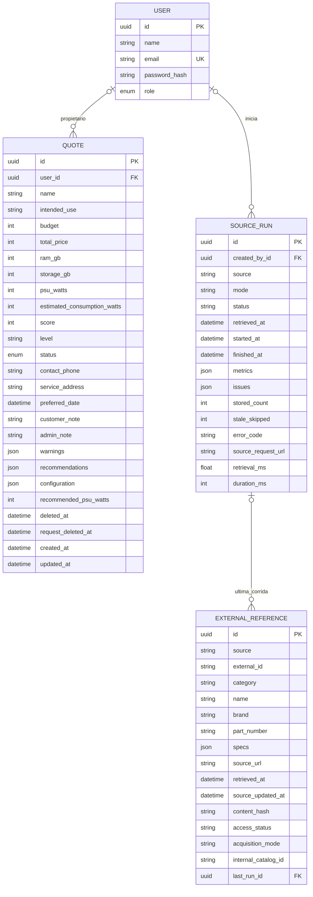

# Modelo de datos — EP2

Actualizado: 2026-10-17. Resumen del esquema vigente en `backend/prisma/schema.prisma`; se conserva el nombre histórico del archivo para no romper enlaces. El diagrama omite campos secundarios y no incluye tablas futuras como si existieran.

## Persistencia y relaciones

- `User`: roles `CLIENT` y `ADMIN`; hash de contraseña, nunca contraseña en claro.
- `Quote`: snapshot JSON de catálogo/piezas/cantidades y análisis, además de totales, explicación y coordinación. No depende de consultar SoloTodo para reconstruirse.
- Estados: `DRAFT`, `REQUESTED`, `REVIEWING`, `SCHEDULED`, `COMPLETED`, `EXPIRED`. `deletedAt` retira la cotización de las vistas y `requestDeletedAt` identifica la consulta retirada; no equivalen a borrar físicamente todos sus datos.
- `SourceRun`: auditoría de preparación/recuperación con modo, resultado, métricas, incidencias y tiempos. Sus métricas resumen el lote; no contienen un catálogo histórico completo.
- `ExternalReference`: ficha vigente para `(source, externalId)`, con origen, fechas, hash y modo. `lastRunId` apunta a la última corrida asociada; no es un historial de todas las versiones o de todos los elementos de cada lote.
- Relaciones con usuario y última corrida opcionales, con `SetNull` al eliminar al padre. Retirar una cuenta QA no borra la referencia pública conservada como evidencia.

## Identidad, índices y concurrencia

| Control existente | Propósito |
| --- | --- |
| `User.email` único | Evitar cuentas duplicadas. |
| Índices Quote de fecha, usuario/fecha y estado | Historial privado y coordinación. `updatedAt` permite detectar edición concurrente con el valor esperado. |
| `ExternalReference(source, externalId)` único | Actualizar identidad externa sin duplicarla ni fusionar por nombre. |
| Índices de fuente/categoría/fecha, fuente/marca y vínculo interno | Acceso a referencias. La búsqueda actual es coincidencia de texto, no búsqueda semántica o índice full-text. |
| `SourceRun(source, startedAt)` | Historial y espera. |
| Índice único parcial de corrida API activa | SQL de migración `20261017050000_source_recovery`: impide adquisiciones API concurrentes por fuente entre procesos. No está declarado como índice parcial en Prisma. |

Actualizar fichas y cerrar exitosamente una corrida forma una transacción. Datos más antiguos/conflictivos se omiten y JSON declarado no reemplaza una referencia API. Un fallo no publica un lote parcialmente persistido.

## Funcionalidades pendientes

Catálogo y presets siguen en código; no existen tablas administrables `Component`, `QuoteItem`, `Preset` o `PresetItem`. `internalCatalogId` es un texto opcional para un vínculo futuro, **sin FK a un catálogo persistido ni aprobación administrativa implementada**.

Tampoco hay entidades de modelo de usuario, ranking o aprobación/versionado de fichas. Ver [diseño adaptativo EP2](diseno-adaptativo-ep2.md). Una recuperación exitosa no constituye un mapeo aprobado.
